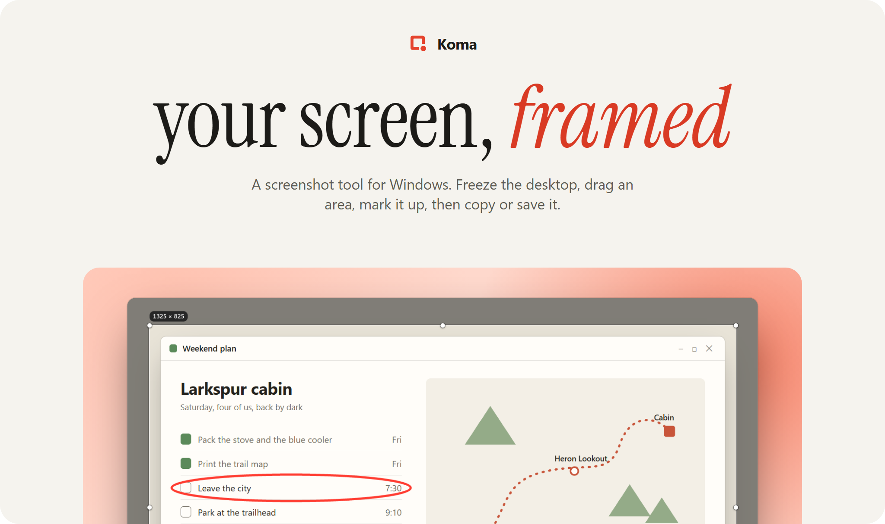
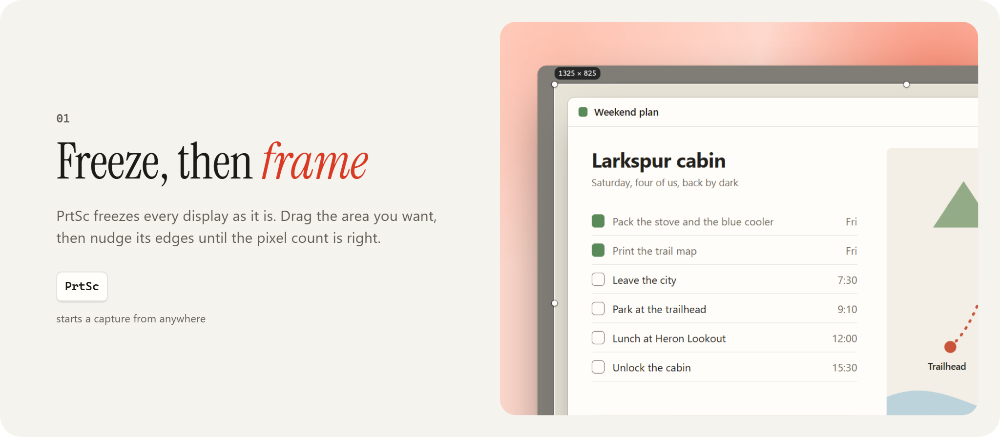
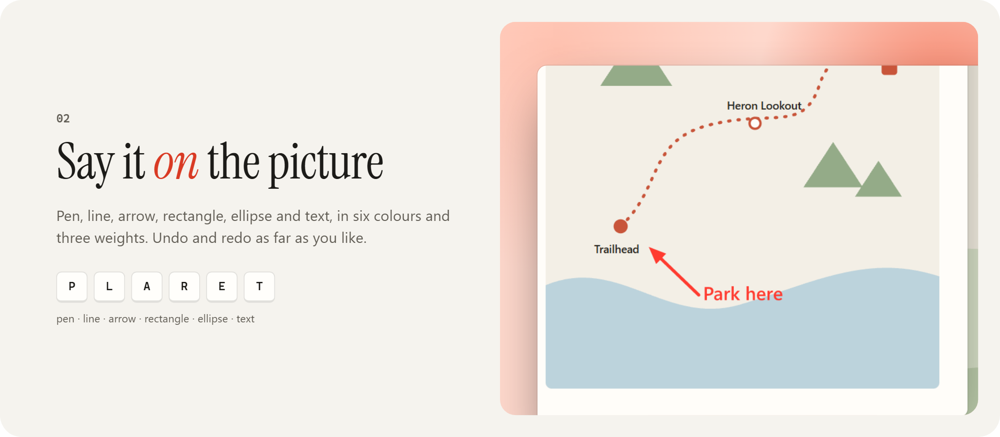
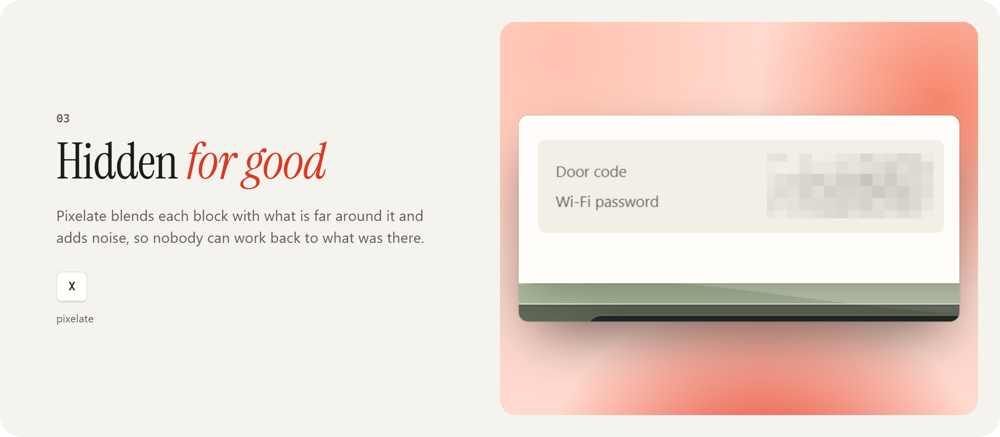
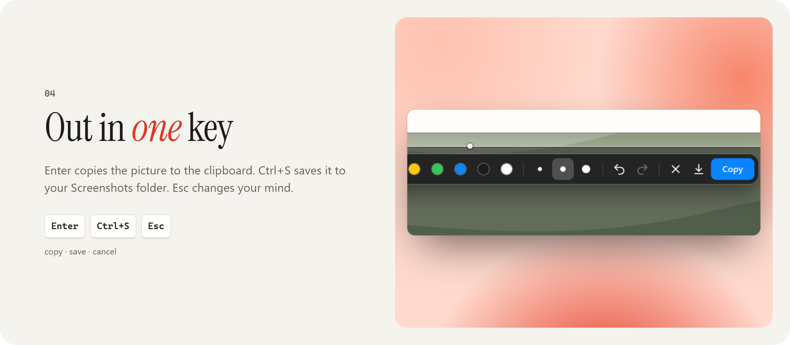

<picture>
  <source media="(prefers-color-scheme: dark)" srcset=".github/readme/hero-dark.png">
  
</picture>

<p align="center">
  <a href="https://github.com/Anthonyy232/Koma/releases/latest/download/Koma.exe"><b>Download Koma for Windows</b></a>
  &nbsp;·&nbsp;
  <a href="https://anthonyy232.github.io/Koma/"><b>Website</b></a>
</p>

Koma is a screenshot tool for Windows. Press PrtSc and the desktop freezes; drag the area you want, draw on it if you need to, then copy it or save it. It is one small program with no installer and no account, and it never touches the network.

<picture>
  <source media="(prefers-color-scheme: dark)" srcset=".github/readme/feature-select-dark.png">
  
</picture>

A capture pictures every display at once, so menus and tooltips stay as they were. Then:

- **Drag** anywhere to select an area. Its size in pixels shows at the corner.
- **Drag an edge or a corner** to resize it, or drag inside it with the Move tool to shift it.
- **Drag outside it** to start over. Once you have drawn on the picture, a press outside does nothing, so a slip can't lose your marks.
- With no area selected, Copy and Save take the whole desktop.

Starting Koma, or opening it again while it is running, also starts a capture.

<picture>
  <source media="(prefers-color-scheme: dark)" srcset=".github/readme/feature-marks-dark.png">
  
</picture>

| Key | Tool                          |
| :-: | ----------------------------- |
| `V` | Move the selection            |
| `P` | Pen                           |
| `L` | Line                          |
| `A` | Arrow                         |
| `R` | Rectangle                     |
| `E` | Ellipse                       |
| `T` | Text: click, type, then Enter |
| `X` | Pixelate                      |

The toolbar has six colours (red, yellow, green, blue, black and white) and three weights, which also set the size of text. `Ctrl+Z` undoes the last mark, and `Ctrl+Shift+Z` or `Ctrl+Y` brings it back.

<picture>
  <source media="(prefers-color-scheme: dark)" srcset=".github/readme/feature-pixelate-dark.png">
  
</picture>

Ordinary pixelation can be undone: pixelate guesses until one matches. Koma colours each block from an area much wider than a letter and adds a little random noise that differs on every capture, so what was underneath can't be worked back out.

<picture>
  <source media="(prefers-color-scheme: dark)" srcset=".github/readme/feature-deliver-dark.png">
  
</picture>

| Key                | Action                                            |
| ------------------ | ------------------------------------------------- |
| `Enter` or `Ctrl+C` | Copy the picture to the clipboard                 |
| `Ctrl+S`           | Save it to your Screenshots folder                |
| `Esc`              | Cancel the capture, or the text you are typing    |

Saved pictures are PNG files named the way Windows names its own, such as `Screenshot 2026-11-11 142307.png`. The frozen pictures of your desktop are deleted as soon as the capture ends.

## Install

Download [Koma.exe](https://github.com/Anthonyy232/Koma/releases/latest/download/Koma.exe), put it wherever you keep programs, and run it. There is nothing to install. Koma needs 64-bit Windows 10 or 11.

Koma isn't code-signed, so Windows SmartScreen may warn the first time: choose **More info**, then **Run anyway**.

It lives in the notification area. Its menu there has **Start at login** and **Exit**.

### If PrtSc opens Snipping Tool instead

Windows keeps PrtSc for its own Snipping Tool until you tell it otherwise, and Koma says so when that happens. In Windows Settings, go to **Accessibility**, then **Keyboard**, and turn off **Use the Print screen key to open screen capture**. If another app holds the key, Koma tells you that too.

## Building from source

You need git, [rustup](https://rustup.rs), [Bun](https://bun.sh) 1.4.2 and the Windows SDK, whose `fxc.exe` must be on your `PATH`. In PowerShell:

```powershell
scripts\setup.ps1
cargo build --release -p koma-windows
```

`setup.ps1` fetches [Exact](https://github.com/expo/exact), the framework Koma is written in, at the commit Koma pins, and applies Koma's patch to it. The program is built to `target\release\Koma.exe`. `scripts\check.ps1` runs the formatter, the lints and the tests.

## Contributing

Contributions are welcome. Read [AGENTS.md](AGENTS.md) before opening a pull request.

If Koma is useful to you, you can support it through [GitHub Sponsors](https://github.com/sponsors/Anthonyy232).

## License

Copyright (c) 2026 Anthony La.

Koma is free software, licensed under the [GNU General Public License v3.0](LICENSE) only, and comes with no warranty.

Koma is built on [Exact](https://github.com/expo/exact) by Expo, which is under the MIT License; `patches/exact-overlay.patch` changes Exact's code and stays under that license.
